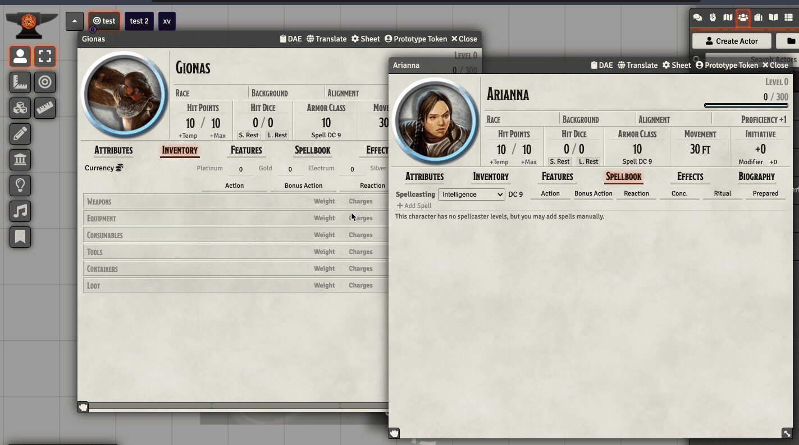
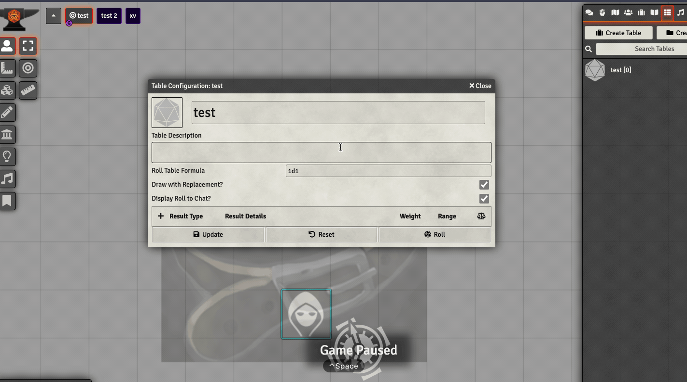
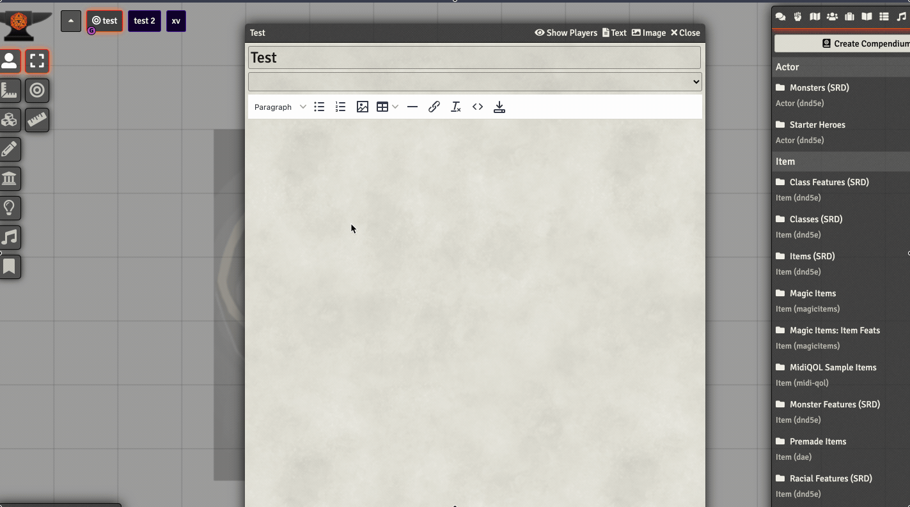
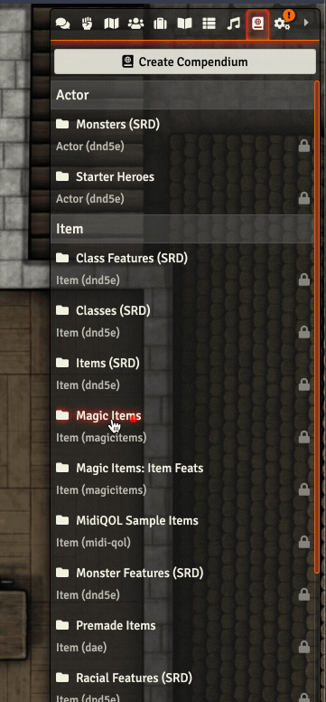
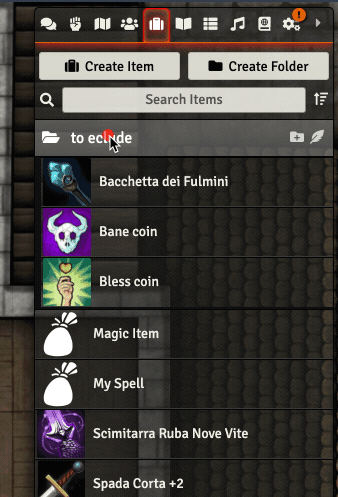
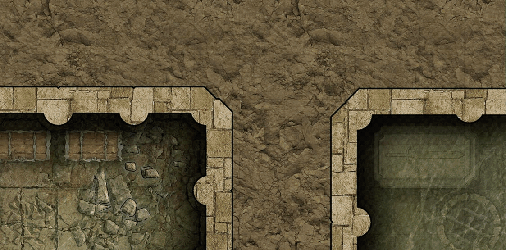
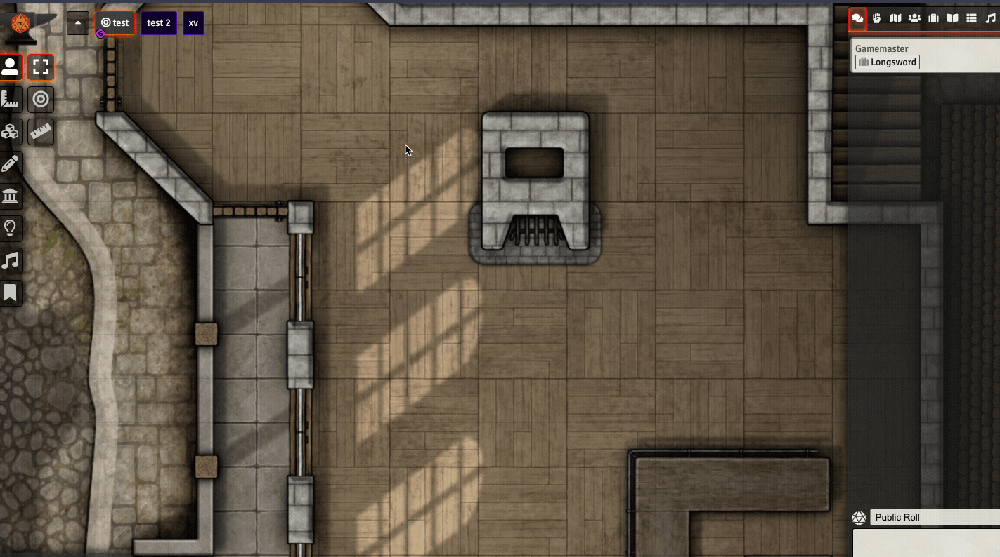
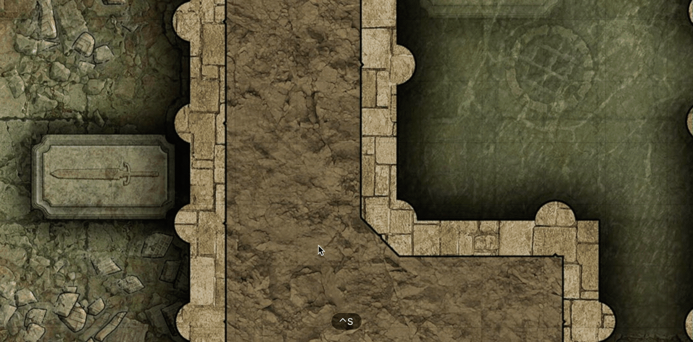
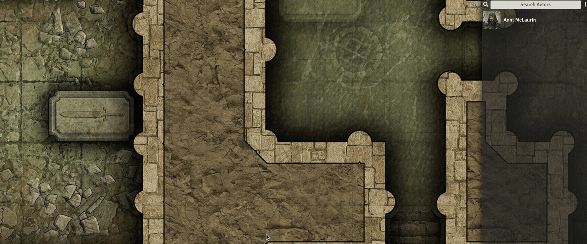
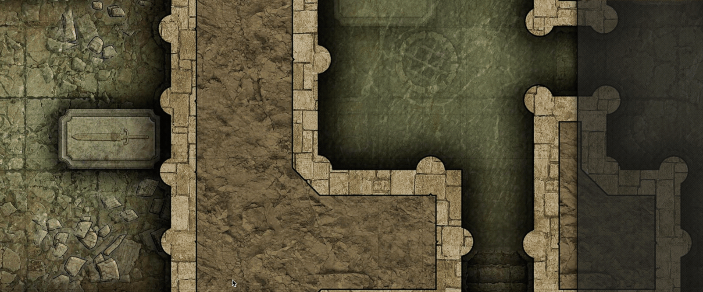

# FoundryVTT Search Anywhere

A FoundryVTT Module that adds a way to quickly search for any entity by name via a handy auto-complete widget.   
Search Anywhere is specifically designed to streamline and speed up the search workflow using quick keyboard shortcuts.

## Usage Instructions

Hit <kbd>ctrl</kbd> + <kbd>space</kbd> (or the key combination you overwrote in the settings) and start typing. Select an entry using <kbd>up</kbd>/<kbd>down</kbd> arrow keys and hit <kbd>enter</kbd> to show the search menu. Select the preferred option with <kbd>up</kbd>/<kbd>down</kbd> arrow keys and hit <kbd>enter</kbd> again: that's it.
Of course, you can always use the mouse, but I advise you to get used to the few keyboard commands, you won't regret it ;).

If you use spotlight (or Alfred) on the mac, you can easily guess what this module is inspired by ;)

Currently supports searchs over: 

*  Actors (characters and NPCs)
*  Items
*  Scenes
*  Journals
*  Rollable Tables
*  Compendium
*  Playlists

## From version 2.2.0:

**New contextual actions in the command menu**   
   
If there are opened sheets, you can use the search result by adding it directly through the context menu:

Similarly, if there is an opened roll table sheet:

And in any text editor in the foreground:

**Exclude compendium/directories from the search**

It is now possible to exclude compendium from the search: click on "Toggle Searching" in the right-click menu of the compendium you want to exclude:

Similarly, it is also possible to exclude directories from the search: click on "Toggle Searching" in the right-click menu that appears for the directory you want to exclude. It will exclude all its contents and the contents of other internal directories recursively:

For both, the icon of a magnifier with a minus sign indicates that that compendium/directory will be excluded from the search.   
To re-include them in the search, select "Toggle Searching" again.   
After an exclusion/inclusion operation, the search will be re-indexed.

## From version 2.0:

- Significant performance increase via flexsearch indexing, even in worlds with huge amount of data.
- Search by multiple words, order independent.

- Search by assonance or similar words:

- Full text content search inside Journal Entries, Item description, Actor bio & Rollable Table description (world's entity only)
- Better indication of the source of the suggestion (compendium/type).
- Thumbnail image preview (where present).
- Type-filtered search binded with specific keymap (fully customizable in the settings). Ex. press 'Ctrl + m' to Macro only search. 
- Multiple choice of commands at the entity selection:

	- open: open the entity sheet (for scenes, the scene itself is displayed)
	- copy reference: clipboard copy of the entity reference. 
	- send reference in chat: create a chat message with the entity reference.
	- execute: only for Macro, runs the macro.
	- roll: only for Rollable Tables, roll the table and diplay the result in chat.
	- activate: only for Scenes
	- configure: only for Scenes, open the configuration sheet of the scene.
	- open journal Note: only for Scenes, open the associated Journal Note.
	- import: only for compendium entities, directly imports the selected entity in the world.
    - play/stop: only for playlists, start or stop playing of the found playlist.
	
	

- Execute chat commands directly from the search: type '/' and see what commands you can execute. 

- Disable search for players.	
- Internationalization support.

## From version 1.1: Added the ability to drag the entity directly from the window!

The module adds a small drag handler in the lower left corner of the window that allows to drag and drop directly from the opened sheet.

NEW: From version 2.2.0 it is possible to disable this function from the module settings

## Installation

To install, follow these instructions:

1.  Inside Foundry, select the Game Modules tab in the Configuration and Setup menu.
2.  Click the Install Module button and enter the following URL: https://gitlab.com/riccisi/foundryvtt-search-anywhere/raw/master/module/module.json
3.  Click Install and wait for installation to complete

## Compatibility

Tested on 0.3.9 version.

## Feedback

Every suggestions/feedback are appreciated, if so, please contact me on discord (Simone#6710)

## License

FoundryVTT Search Anywhere is a module for Foundry VTT by Simone and is licensed under a [Creative Commons Attribution 4.0 International License](http://creativecommons.org/licenses/by/4.0/).

This work is licensed under Foundry Virtual Tabletop [EULA - Limited License Agreement for module development v 0.1.6](http://foundryvtt.com/pages/license.html).