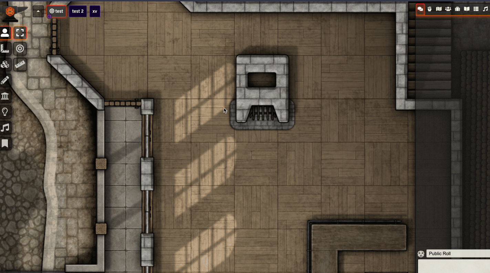
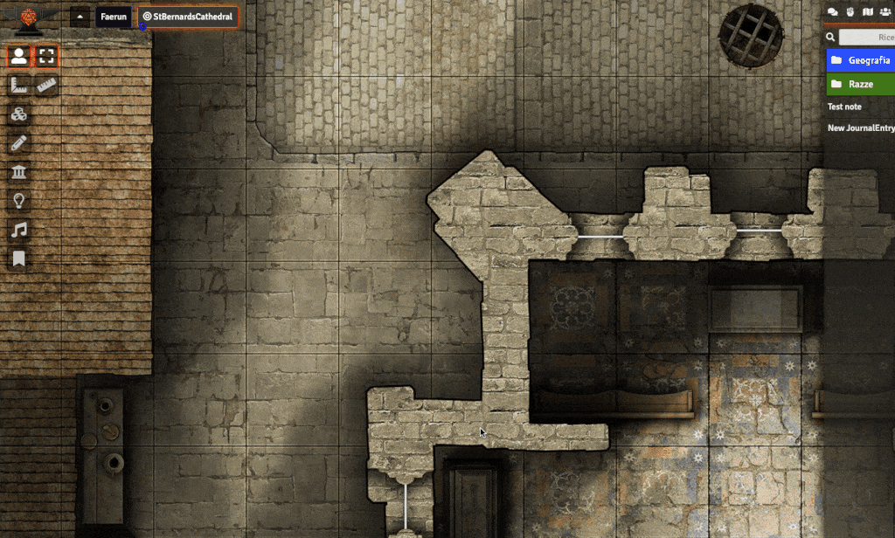

# FoundryVTT Search Anywhere

A FoundryVTT Module that adds a way to quickly search for any entity by name via a handy auto-complete widget.

Currently supports searchs over: 

*  Actors (characters and NPCs)
*  Items
*  Scenes
*  Journal
*  Rollable tables
*  Compendium

## From version 1.1: Added the ability to drag the entity directly from the window!

The module adds a small drag handler in the lower left corner of the window that allows to drag and drop directly from the opened sheet.

## Installation

To install, follow these instructions:

1.  Inside Foundry, select the Game Modules tab in the Configuration and Setup menu.
2.  Click the Install Module button and enter the following URL: https://gitlab.com/riccisi/foundryvtt-search-anywhere/raw/master/module/module.json
3.  Click Install and wait for installation to complete

## Usage Instructions

Hit <kbd>ctrl</kbd> + <kbd>space</kbd> and start typing. Select an entry using <kbd>up</kbd>/<kbd>down</kbd> arrow keys and hit <kbd>enter</kbd> to show the selected sheet. 

## Compatibility

Tested on 0.3.9 version.

## Feedback

Every suggestions/feedback are appreciated, if so, please contact me on discord (Simone#6710)

## License

FoundryVTT Search Anywhere is a module for Foundry VTT by Simone and is licensed under a [Creative Commons Attribution 4.0 International License](http://creativecommons.org/licenses/by/4.0/).

This work is licensed under Foundry Virtual Tabletop [EULA - Limited License Agreement for module development v 0.1.6](http://foundryvtt.com/pages/license.html).